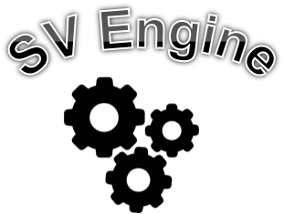
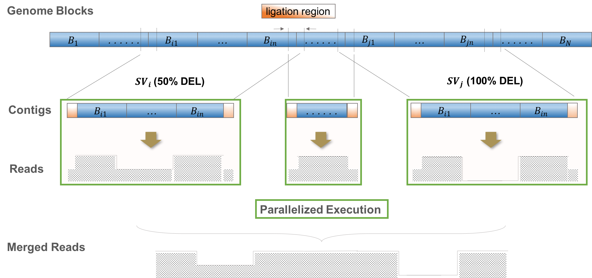
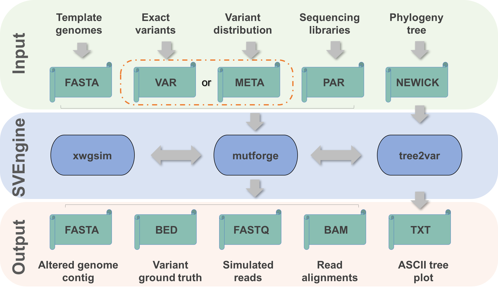

|Logo| SVEngine: Allele Specific and Haplotype Aware Structural Variants Simulator
==================================================================================

QUICK LINKS
-----------

`Examples <doc/Example.rst>`__

`Manuals <doc/Manual.rst>`__

`FAQ <doc/FAQ.rst>`__

INTRODUCTION
------------

  SVEngine (Structural Variants Engine)

  - SVEngine is a multi-purpose and self-contained simulator for whole genome scale spike-in of thousands of SV events of various types in both single-sample and matched sample scenarios.

  - SVEngine takes as input reference contigs in FASTA files, variant meta distribution as specified in META files (see Manual) or specific variant information as specified in VAR files (see Manual) and NEWICK files for specifying clonal phylogenetic trees in cancer.

  - SVEngine outpus alterred contigs in FASTA files, spiked-in variants in VAR files (see Manual), simulated short read in FASTQ files and aligned short reads in BAM files.

  - SVEngine's modeling and pipeline are illustrated in Figures 1 and 2.

  Figure 1. The principle and workflow of SVEngine.

  |Rationale|

  Figure 2. The bioinformatics pipeline of SVEngine.

  |Pipeline|

Software
-------------------------------------------

  Currently the package works for Linux (tested with Ubuntu) and Mac (tested with Homebrew).
  It might also work for Windows with Cygwin (not tested).
  SVEngine documentation is available in the ``doc/`` folder of this repository
  (RST sources: doc/Example.rst, doc/Manual.rst and doc/FAQ.rst; built HTML: doc/index.html).

DOCKER (Platform Indepedent and Preferred)
---------------------------------------------

  Due to the multiple R and Python dependencies involved,
  the easiest way to use SVEngine is by the provided docker image build file.
  A Dockerfile is provided to build SVEngine-enabled image from a standard Ubuntu docker image.
  If you are not familiar with Docker, it is a container platform widely used in industry/academia. 
  Here is the link to the Docker community:
    docker community: https://www.docker.com
  If you have a docker server running, 
  just need to download the Dockerfile from: 
    dockerfile: `Dockerfile <Dockerfile>`__
  into $your_sve_container and run:

  ::

    docker build --no-cache $your_sve_container

INSTALL
------------

  SVEngine is available on GitHub: https://github.com/labxscut/svengine.git

  *Dependencies*:

    Python2(>=2.7)  http://www.python.org/

      pybedtools, pysam, pandas, tables, scipy, dendropy, cython

    Samtools>=1.2, Bedtools>=2.0, BWA>=0.7

    A script to confirm all dependencies are met is here:

      `test/test_dep.sh <test/test_dep.sh>`__

    An example dependency install script for Mac wth Homebrew is here:

      `test/install_mac.sh <test/install_mac.sh>`__

  *Installation*

    You can install SVEngine as a standard package to your site python without virtualenv, in particular when all python dependencies are already met. Before you take this approach, please consider following virtualenv based installation first. The following guides were intended for Ubuntu, while Mac Homebrew user may easily adapt by removing sudo.

    The other option is to use virtualenv based non-root installation, which separates svengine from site python. virtualenv command is standard with Python 2.7 or later. see: http://python-guide-pt-br.readthedocs.io/en/latest/dev/virtualenvs/. If it is not present, please see https://virtualenv.pypa.io for details to install virtualenv for your python. 

    .. code::

      sudo easy_install pip
      sudo pip install virtualenv

    Ask your IT manager to help install it for you if you have permission difficulties.
    When your system python has virtualenv, make sure your $PYTHONPATH is set to empty.
    Follow steps below:

    .. code::

      sudo pip install --upgrade pip
      virtualenv svengine_vpy

    Now you can activate this virtual python for installing SVEngine python dependencies:

    .. code::

      # in svengine_vpy>
      source svengine_vpy/bin/activate
      pip install -U scipy
      pip install -U tables
      pip install -U pandas
      pip install -U pysam
      pip install -U pybedtools
      pip install -U dendropy
      pip install -U biopython
      pip install -U cython

    Then install svengine as an standard python package:

    .. code::

      # in svengine_vpy>
      git clone https://github.com/labxscut/svengine.git
      cd svengine
      git submodule update --init --recursive
      test/test_dep.sh
      python setup.py install

    Now the SVEngine executables will be available from "$PWD/svengine_vpy/bin".

    Because you installed SVEngine via virtualenv, remember to activate the virtualenv every time you use SVEngine. Also export the environmental variable $SVENGINE_BIN=$PWD/svengine_vpy/bin and add it to your $PATH.

EXECUTABLES
-----------

    xwgsim        --  enhanced Heng Li's wgsim

    mutforge      --  spiking in structure variants without fasta output 

    tree2var      --  updating variant with a phylogenetic tree structured frequency

USAGE
------------

  By default all above executables will be available from $SVENGINE_BIN/ .
  Use '-h' to read script-wise usage.
  See the manuals and examples under doc/ for more details.

LICENSE
------------

  BSD3

WIKI
------------

  SVEngine's manuals, FAQs and other documentation are maintained in the ``doc/`` folder of this repository (see `doc/Manual.rst <doc/Manual.rst>`__, `doc/Example.rst <doc/Example.rst>`__ and `doc/FAQ.rst <doc/FAQ.rst>`__). This is a MUST read before you actually use the SVEngine tool. Contributions to this documentation are welcome.

FAQ
------------

  `doc/FAQ.rst <doc/FAQ.rst>`__

BUG
------------

  https://github.com/labxscut/svengine/issues

CONTACT
------------

  Questions and comments shall be addressed to hanleeji at stanford dot edu and/or lixia at stanford dot edu.

CITATIONS
---------

	1. SVEngine: an efficient and versatile simulator of genome structural variations with features of cancer clonal evolution. Li Charlie Xia  Dongmei Ai  Hojoon Lee  Noemi Andor  Chao Li  Nancy R Zhang  Hanlee P Ji. GigaScience, 2018, giy081 (https://academic.oup.com/gigascience/advance-article/doi/10.1093/gigascience/giy081/5049476)

